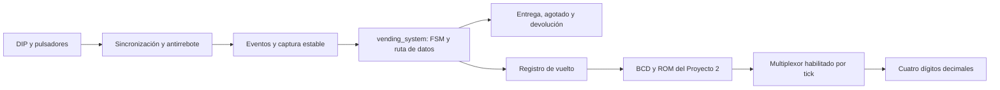

# Proyecto Corto 3 — EL-3307

Máquina expendedora para Tang Nano 9K, descrita en SystemVerilog con un único reloj de 27 MHz. La FSM One-Hot controla una ruta de datos separada y un display decimal de cuatro dígitos muestra el vuelto durante la entrega.

## Interfaz y funcionamiento

- `product_sw[1:0]`: DIP de producto; códigos lógicos `00=A`, `01=B`, `10=C`. `11` se rechaza.
- `coins_sw[2:0]`: DIP de cantidad de monedas de ₡100; entre cero y siete monedas.
- `start_n`: confirma una solicitud estable; `restart_n`: termina una compra sin reponer existencias.
- `reset_n`: reset global; restablece tres unidades de cada producto.
- `delivery_led_n[2:0]` y `empty_led_n[2:0]`: entrega y agotamiento A/B/C, activos bajos.
- `refund_led`: devolución activa alta durante dos segundos; no se acepta otra compra mientras está visible.
- `an[3:0]` y `sseg[7:0]`: selectores y segmentos del display; el bit 7 es DP y los bits 6 a 0 son a, b, c, d, e, f y g.

Los pulsadores y DIP utilizan pull-up y cierre a GND. El top sincroniza, invierte y elimina rebotes; cada pulsación produce un solo evento. Producto y crédito se capturan antes de solicitar la operación al núcleo y se conservan aunque cambien los DIP.

| Producto | Precio | Ejemplo de entrada | Vuelto mostrado |
|---|---:|---:|---|
| A | ₡150 | 2 monedas = ₡200 | `0050` |
| B | ₡275 | 3 monedas = ₡300 | `0025` |
| C | ₡400 | 4 monedas = ₡400 | `0000` |

El display permanece visible hasta RESTART. En reset, reposo y devolución queda apagado. El pago insuficiente y el producto agotado devuelven todo el crédito sin consumir inventario. Los eventos de entrega se conservan en registros para señalización; el decremento original sigue durando un ciclo.

## Arquitectura y reutilización



`vending_fsm` separa registro de estado, siguiente estado y salidas. `vending_system` conserva los registros, inventarios y cálculos existentes. `vending_display` reutiliza `bcd_converter`, `rom_reg`, `tick_generator` y `disp_hex_mux` del Proyecto 2.

La ROM original convierte 0–999. El adaptador separa millares y resto para representar 0–1023. Consulta direcciones 0–499 de una ROM de 512 entradas: para restos de 500–999 resta 500 antes de convertir y suma cinco a las centenas. Esto evita el límite de inferencia de Gowin sin cambiar la tabla original. La extensión `USE_TICK` del multiplexor conserva su funcionamiento previo por defecto; el display nuevo habilita el avance mediante pulsos y mantiene `clk` en todos los registros.

Valores de hardware: `DEBOUNCE_N=21`, `REFUND_CYCLES=54000000`, `DISPLAY_DIV=6750`. El refresco tiene 4000 ranuras por segundo y 1000 recorridos completos por segundo. Las polaridades se seleccionan con `SEGMENTS_ACTIVE_LOW` y `DIGITS_ACTIVE_LOW`; ambas son cero por defecto para conservar la interfaz digital del Proyecto 2.

## Verificación y compilación

Desde la raíz del repositorio, para todos los bancos RTL de los Proyectos 2 y 3:

```powershell
powershell.exe -NoProfile -ExecutionPolicy Bypass -File EL-3307_Proyecto_Corto_3/src/sim/run_questa.ps1
```

La regresión excluye el banco histórico `tb_top_post_route` del Proyecto 2 porque necesita su netlist y SDF propios; ejecutarlo contra RTL no demostraría temporización post-ruteo. Las pruebas de implementación del Proyecto 3 se documentan separadamente en el informe de auditoría.

Para síntesis, colocación, ruteo y análisis temporal con Gowin:

```powershell
& 'C:\Gowin\Gowin_V1.9.11.03_Education_x64\IDE\bin\gw_sh.exe' 'EL-3307_Proyecto_Corto_3/src/build/vending_top_gowin.tcl'
```

El flujo prepara las primeras 512 entradas de la ROM original, incorpora las dependencias y utiliza `vending_top.cst` y `vending_top.sdc`. No invoca programación de la placa. El Makefile de `src/build` ofrece objetivos equivalentes y no tiene un objetivo de carga automática.

Para construir la variante de verificación y simular las netlists:

```powershell
powershell.exe -NoProfile -ExecutionPolicy Bypass -File EL-3307_Proyecto_Corto_3/src/sim/run_questa_netlist.ps1
```

Resultado del 17/11/2026: 30 bancos RTL, 53 190 comprobaciones y cero errores; post-ruteo con SDF, 505 comprobaciones y cero errores. Gowin completó síntesis, PnR y STA del hardware a 27 MHz, con Fmax de 53,526 MHz. **Verificación incompleta:** Questa no acepta la protección GOWIN del `.vg` post-síntesis. El flujo de netlists devuelve estado `PARTIAL` y salida distinta de cero; no certifica la versión final. La simulación SDF usa divisores reducidos y no sustituye el STA de la implementación con parámetros reales.

Los resultados, bibliotecas y proyectos generados se guardan bajo `work/`, excluido de Git. Las cifras de pruebas y de temporización ejecutadas se recogen en [el informe de auditoría y verificación](doc/auditoria_y_verificacion.md).

## Montaje y alcance

Consultar [preparación de la Tang Nano 9K](doc/preparacion_tangnano9k.md) para las 28 conexiones, voltajes, resistencias y transistores. La intención es reutilizar el montaje del Proyecto 2, pero el repositorio no identifica el modelo real del display ni el circuito de sus selectores. La interfaz activa alta está verificada digitalmente; la equivalencia con el montaje físico todavía debe comprobarse. No conectar los comunes directamente a GPIO sin comprobar su corriente y su etapa de selección.

La interfaz física exige monedas de ₡100, mientras los ejemplos del PDF incluyen ₡150 y ₡125. Esos importes se prueban directamente en el núcleo, sin inventar nuevas monedas ni una entrada CANCEL que el enunciado no define.

## Documentación

- [Arquitectura](doc/arquitectura_general.md) y [diagrama de bloques](doc/diagrama_bloques.md).
- [Estados](doc/diagrama_estados_fsm.md), [transiciones](doc/tabla_transiciones_fsm.md), [salidas](doc/tabla_salidas_control_fsm.md) y [ecuaciones](doc/ecuaciones_fsm.md).
- [Auditoría y resultados](doc/auditoria_y_verificacion.md), con los rastros originales y las correcciones.
- [Enunciado original](doc/Proyectos_Proyecto-Corto-3-II-Semestre-2026.pdf), conservado sin editar como documento de referencia.

Base conceptual: Harris & Harris, *Digital Design and Computer Architecture*, capítulos de lógica secuencial y descripción de hardware; [materiales de los autores](https://pages.hmc.edu/harris/ddca/ddcarv.html).
