# Diagrama de bloques del sistema

La vista corresponde a la integración funcional. El control genera habilitaciones; los registros y la aritmética pertenecen a la ruta de datos. El vuelto llega al display decimal.

```mermaid
flowchart LR
    CONTACTS["START, RESTART y cinco bits DIP"] --> SYNC["Sincronizadores"]
    SYNC --> NORMALIZE["Invertir contactos activos bajos"]
    NORMALIZE --> DEB["Antirrebote independiente"]
    DEB --> GUARD["Guardas de arranque y estabilidad"]
    GUARD --> EVENTS["Eventos de pulsación"]
    EVENTS --> CAP["Captura conjunta de producto e importe"]
    CAP --> BUSY["Reserva de transacción"]
    CAP --> REQ["request_event retardado"]

    subgraph CORE["vending_system"]
        FSM["FSM One-Hot: nueve estados"]
        REGS["Selección, crédito capturado y operandos"]
        PRICE["Selector de precio"]
        SUB["Restador registrado"]
        INV["Inventarios A/B/C"]
        DEC["Disponibilidad y autorización"]
        CHANGE["change_reg"]
        FSM -->|"capturas y cargas"| REGS
        REGS --> PRICE
        PRICE --> REGS
        REGS --> SUB
        FSM -->|"calculate_balance"| SUB
        INV --> DEC
        REGS -->|"producto capturado"| DEC
        SUB -->|"signo y result_valid"| DEC
        DEC --> FSM
        SUB -->|"magnitude"| CHANGE
        FSM -->|"load_change"| CHANGE
        FSM -->|"decrement_A/B/C"| INV
    end

    REQ --> FSM
    CAP -->|"producto e importe retenidos"| REGS
    EVENTS -->|"restart_event"| FSM
    FSM -->|"clear_transaction"| BUSY
    FSM -->|"clear_transaction"| REGS
    FSM -->|"clear_transaction"| CHANGE
    FSM -->|"decrement_A/B/C"| DELIVERY["Registro visual de entrega"]
    FSM -->|"refund_active"| REFUND["Registro visual y timer de dos segundos"]
    INV --> EMPTY["LED de agotado"]
    DELIVERY --> LED["LED de entrega"]
    REFUND --> REFUNDLED["LED de devolución"]
    REFUNDLED -->|"inhibir solicitudes durante indicación"| BUSY
    BUSY -->|"permitir nueva captura"| CAP

    subgraph DISPLAY["vending_display"]
        FORMAT["Separar millar y normalizar resto a 0–499"]
        BCD["bcd_converter N=9 y rom_reg; corregir centenas"]
        TICK["tick_generator"]
        MUX["disp_hex_mux: N=2, USE_TICK=1"]
        POLARITY["Adaptar polaridad y blanco"]
        FORMAT -->|"resto normalizado"| BCD
        BCD -->|"centenas, decenas, unidades"| MUX
        FORMAT -->|"millar"| MUX
        TICK -->|"habilitación tick_display"| MUX
        MUX --> POLARITY
    end

    CHANGE --> FORMAT
    DELIVERY -->|"display_enable"| POLARITY
    POLARITY --> SEG["an de cuatro dígitos y sseg"]

    CLK["Único reloj de 27 MHz"] --> SYNC
    CLK --> DEB
    CLK --> CAP
    CLK --> FSM
    CLK --> REGS
    CLK --> SUB
    CLK --> INV
    CLK --> CHANGE
    CLK --> DELIVERY
    CLK --> REFUND
    CLK --> TICK
    CLK --> MUX
    S1["S1: reset global"] --> RESET["Afirmar reset y sincronizar liberación"]
    RESET -->|"FSM, datos, filtros, temporizadores y presentación"| CORE
```

## Lectura funcional

1. Los siete contactos se sincronizan y filtran. Las guardas evitan eventos de arranque y capturas durante cambios de los DIP.
2. START aceptado retiene producto e importe antes de enviar la solicitud. La reserva evita reemplazar esos datos durante una operación.
3. El core captura crédito y producto en flancos diferentes, pero ambos provienen del mismo snapshot retenido.
4. Se cargan operandos, se lanza la resta y se consume el resultado en flancos consecutivos separados.
5. Una entrega genera un decremento único. El registro visual mantiene LED y display hasta RESTART.
6. Pago insuficiente o producto agotado generan devolución automática sin consumir inventario. El LED temporizado sobrevive a la limpieza del core.
7. El vuelto llega al conversor decimal y al multiplexor de cuatro dígitos. Su refresco utiliza una habilitación del reloj principal.
8. El reset global restaura inventarios y reinicia todos los bloques. RESTART limpia únicamente una transacción terminada.

El display muestra ceros iniciales y queda en blanco fuera de la presentación de entrega. Las polaridades se configuran en vending_display y no determinan por sí solas el tipo físico del display ni el driver utilizado.

Los pines y niveles eléctricos se describen en [preparacion_tangnano9k.md](preparacion_tangnano9k.md). El diagrama no utiliza una habilitación como un reloj adicional.
