# Diagrama preliminar de bloques

## Alcance y convenciones

Este diagrama traduce a una vista de interconexión el análisis preliminar de [`diseno_subsistemas.md`](./diseno_subsistemas.md). Se basa en el enunciado oficial del Proyecto Corto 3 y en Harris y Harris, *Digital Design and Computer Architecture, ARM Edition*, especialmente las secciones 3.4 (*Finite State Machines*), 4.6 (*Finite State Machines en HDL*) y 5.2 (*Arithmetic Circuits*). La FSM se representa separada de la ruta de datos: la unidad de control decide cuándo operar y la ruta de datos conserva registros y realiza cálculos.

El diagrama es una propuesta para revisión, no una arquitectura aprobada. Las etiquetas indican:

- **REQ:** función o relación exigida expresamente por el enunciado.
- **PROP:** interfaz, nombre de señal o interconexión propuesta para el diseño; debe revisarse por el grupo.
- **AISLADO:** bloque descrito en el enunciado con la instrucción «No conecte este bloque». La conexión punteada muestra únicamente una posible interfaz para análisis y no representa una conexión permitida.

Las señales como `load_price`, `calculate_balance` o `credit_sufficient` son nombres ilustrativos, no identificadores prescritos por el enunciado. Las ambigüedades sobre el formato de monedas, cancelación, temporizadores y display quedan abiertas.

## Diagrama Mermaid

```mermaid
flowchart LR
    subgraph EXT["Entradas externas"]
        PROD["DIP PROD_SEL<br/>selección A, B o C"]
        COINS["DIP IN_COINS<br/>cantidad/valor aún por aclarar"]
        START["Botón START"]
        RESTART["Botón RESTART<br/>otra transacción, conserva inventario"]
        S1["Botón S1<br/>reset global, inventario a 3"]
        CLK["Reloj Tang Nano 9K<br/>27 MHz"]
    end

    subgraph INPUTS["Lectura y acondicionamiento"]
        SYNC_DIP["Sincronización<br/>de PROD_SEL / IN_COINS"]
        SYNC_BTN["Sincronización<br/>de START / RESTART"]
        DEB["Antirrebote de pulsadores<br/>según interfaz acordada"]
        CAP["Captura y decodificación<br/>de solicitud"]
        RST_ADAPT["Acondicionamiento/adaptación<br/>de reset; polaridad y sincronía<br/>por confirmar"]
        RST["Distribución de reset<br/>a bloques secuenciales"]
    end

    subgraph CONTROL["Unidad de control"]
        FSM["FSM principal<br/>codificación One-Hot"]
    end

    subgraph DATA["Ruta de datos síncrona"]
        REGS["Registros de solicitud<br/>producto seleccionado"]
        PRICE["Registro de precio<br/>₡150 / ₡275 / ₡400"]
        CREDIT["Registro de crédito"]
        INV["Registros de inventario<br/>A=3, B=3, C=3 al reset"]
        SUB["Restador<br/>crédito - precio"]
        FLAGS["Decisión de condición<br/>solo con result_valid=1"]
        CHANGE["Registro de vuelto<br/>change_reg"]
    end

    subgraph TIME["Temporización"]
        EN["Divisores desde 27 MHz<br/>pulsos de habilitación"]
        TMR["Temporizadores de FSM<br/>intervalos de 2 s requeridos;<br/>uso y cantidad por definir"]
    end

    subgraph OUTPUTS["Indicadores"]
        DELIVER["LEDs de entrega<br/>A / B / C"]
        EMPTY["LEDs de agotado<br/>A / B / C"]
        REFUND["LED de devolución"]
    end

    subgraph DISPLAY["Despliegue: AISLADO"]
        BCD["Conversión binario a decimal<br/>interfaz por definir"]
        MUX["Multiplexor de cuatro displays<br/>interfaz por definir"]
        SEG["Displays de 7 segmentos<br/>NO CONECTAR hasta aclarar el enunciado"]
    end

    PROD -->|"REQ: entrada externa sincronizada"| SYNC_DIP
    COINS -->|"REQ: entrada externa sincronizada"| SYNC_DIP
    START -->|"REQ: entrada externa sincronizada"| SYNC_BTN
    RESTART -->|"REQ: entrada externa sincronizada"| SYNC_BTN
    SYNC_DIP -->|"PROP: valores de DIP; no se presume antirrebote de pulsador"| CAP
    SYNC_BTN -->|"REQ: además, eliminar rebote potencial"| DEB
    DEB -->|"PROP: eventos de START / RESTART"| CAP
    CAP -->|"PROP: start_event, selected_product, coin_input_value"| REGS
    CAP -->|"PROP: request_valid"| FSM
    CAP -->|"REQ: RESTART inicia otra transacción sin borrar inventario"| FSM
    REGS -->|"PROP: product_code para selección de precio"| PRICE
    REGS -->|"PROP: coin_value para cargar crédito"| CREDIT
    REGS -->|"PROP: producto seleccionado"| INV

    FSM -->|"REQ: cargar precio; nombre PROP: load_price"| PRICE
    FSM -->|"PROP: load_credit / add_credit / clear_transaction"| CREDIT
    FSM -->|"PROP: pulso único decrement_stock_A/B/C<br/>por producto entregado"| INV
    FSM -->|"REQ: decidir cuándo restar;<br/>nombre PROP: calculate_balance"| SUB
    FSM -->|"PROP: load_change"| CHANGE
    PRICE -->|"PROP: price_value"| SUB
    CREDIT -->|"PROP: credit_value"| SUB
    SUB -->|"PROP: result_valid, magnitude, negative<br/>registrados al calcular"| FLAGS
    FLAGS -->|"PROP: result_valid habilita la decisión;<br/>FSM usa signo/magnitud solo si vale 1"| FSM
    FLAGS -->|"PROP: magnitud si crédito suficiente"| CHANGE
    INV -->|"PROP: selected_available, selected_empty,<br/>inventory_empty_A/B/C"| FSM

    FSM -->|"REQ: control de LEDs;<br/>codificación temporal PROP"| DELIVER
    FSM -->|"PROP: refund_active"| REFUND
    INV -->|"PROP: estado de inventario"| EMPTY

    CLK -->|"REQ: reloj único de 27 MHz"| SYNC_DIP
    CLK -->|"REQ: reloj único de 27 MHz"| SYNC_BTN
    CLK -->|"REQ: reloj único de 27 MHz"| DEB
    CLK -->|"REQ: reloj único de 27 MHz"| CAP
    CLK -->|"REQ: reloj único de 27 MHz"| FSM
    CLK -->|"REQ: reloj único de 27 MHz"| PRICE
    CLK -->|"REQ: reloj único de 27 MHz"| CREDIT
    CLK -->|"REQ: reloj único de 27 MHz"| INV
    CLK -->|"REQ: reloj único de 27 MHz"| SUB
    CLK -->|"REQ: reloj único de 27 MHz"| FLAGS
    CLK -->|"REQ: reloj único de 27 MHz"| CHANGE
    CLK -->|"REQ: reloj único de 27 MHz"| EN
    EN -->|"REQ: pulsos de habilitación, no relojes nuevos"| TMR
    EN -->|"PROP: tick/enable para lógica lenta"| FSM
    FSM -->|"PROP: timer_start / timer_clear"| TMR
    TMR -->|"PROP: timer_done"| FSM

    S1 -->|"REQ: reset global; polaridad por confirmar"| RST_ADAPT
    RST_ADAPT -->|"PROP: adaptación a polaridad/sincronía requerida"| RST
    RST -->|"PROP: reset del estado FSM"| FSM
    RST -->|"PROP: inicializar inventario en tres unidades"| INV
    RST -->|"PROP: limpiar registros temporales"| PRICE
    RST -->|"PROP: limpiar registros temporales"| CREDIT
    RST -->|"PROP: limpiar registros temporales"| CHANGE

    CHANGE -.->|"AISLADO: change_bin; interfaz tentativa"| BCD
    BCD -.->|"AISLADO: dígitos, conversión y refresco por definir"| MUX
    MUX -.->|"AISLADO: segmentos/an; NO conectar"| SEG

    classDef proposed fill:#fff4d6,stroke:#b7791f,color:#111;
    classDef isolated fill:#f2e8f7,stroke:#7d4e9b,color:#111;
    classDef external fill:#eef1f4,stroke:#59636e,color:#111;

    class PROD,COINS,START,RESTART,S1,CLK external;
    class SYNC_DIP,SYNC_BTN,DEB,CAP,RST_ADAPT,RST,REGS,PRICE,CREDIT,INV,SUB,FLAGS,CHANGE,EN,TMR,FSM,DELIVER,EMPTY,REFUND proposed;
    class BCD,MUX,SEG isolated;
```

## Lectura de las interfaces

1. **Entradas:** las entradas externas deben sincronizarse con el reloj del sistema. Los pulsadores `START` y `RESTART` requieren además eliminación de rebote; los DIP `PROD_SEL` e `IN_COINS` tienen una ruta de sincronización/captura separada y no se presume que deban atravesar exactamente el mismo filtro que los pulsadores. La política final de acondicionamiento debe acordarse según la interfaz y las características eléctricas.
2. **Control:** la FSM One-Hot recibe eventos de solicitud, condiciones de la ruta de datos y señales de temporización. Emite órdenes para cargar registros, calcular el saldo, registrar el vuelto y disminuir inventario. La operación aritmética no se ejecuta dentro de la FSM.
3. **Ruta de datos:** contiene registros de precio, crédito, inventario y vuelto, además del restador. El restador entrega `result_valid`, `magnitude` y `negative` como resultados registrados. La FSM solo puede interpretar `negative` o `magnitude` para decidir suficiencia o vuelto cuando `result_valid` vale 1; esas salidas no deben tratarse como una condición nueva o permanentemente válida en otros ciclos. La convención de signo y el ancho deben validarse.
4. **Inventario y reinicio:** una orden de decremento debe ser un pulso único por cada producto efectivamente entregado, no una señal sostenida durante varios ciclos de un estado FSM. `RESTART` inicia otra transacción y conserva inventarios; S1 es el reset global y restaura cada inventario a tres unidades. La polaridad y adaptación/sincronía del reset aún deben confirmarse, especialmente antes de conectar módulos reutilizables con convenciones de reset distintas.
5. **Temporización:** la base es el reloj único de 27 MHz. Las funciones lentas reciben pulsos de habilitación derivados; no se proponen relojes derivados. El destino concreto y la cantidad de temporizadores de 2 s siguen sin especificarse.
6. **Salidas:** la FSM controla las señales de entrega y devolución; el inventario determina las indicaciones de agotado. La duración y forma de estas señales (pulso o nivel) queda pendiente.
7. **Despliegue:** aparece fuera de la ruta conectada. La línea punteada solo indica una posible fuente de datos; no debe realizarse la conexión al circuito hasta que el profesor aclare la instrucción «No conecte este bloque» frente al requisito de mostrar el vuelto.

## Conexiones requeridas y propuestas

El enunciado exige las funciones de acondicionar entradas externas, operar con un único reloj de 27 MHz, separar la FSM de la ruta de datos, generar habilitaciones derivadas del reloj, controlar síncronamente los registros aritméticos e inventarios, y señalar entrega, agotamiento y devolución. Por eso esas relaciones se marcan como **REQ** en cuanto a su función.

Los nombres y la granularidad de las señales entre bloques, el punto preciso de captura de `IN_COINS`, el acondicionamiento específico de los DIP, los eventos de control, el cableado de condición de cada operación y la distribución/adaptación de reset son **propuestas preliminares**. El diagrama no asigna anchuras de palabra, estados de FSM, pines ni polaridades eléctricas. La polaridad y sincronía del reset deben revisarse también frente a las convenciones de reset de los módulos reutilizables.

El despliegue se conserva aislado: el diagrama no interpreta por cuenta propia si «No conecte este bloque» prohíbe solo su conexión física o cualquier integración funcional. La representación de monedas y la relación entre pago insuficiente y cancelación también permanecen pendientes de aclaración, como se detalla en [`diseno_subsistemas.md`](./diseno_subsistemas.md).
