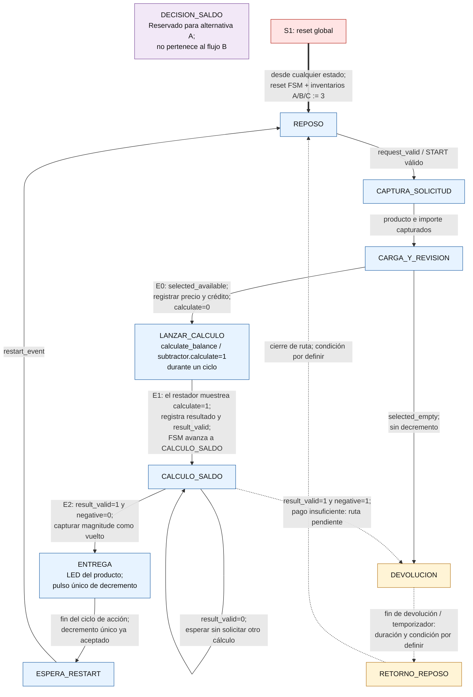

# Diagrama preliminar de estados de la FSM

## Alcance

Este diagrama es una propuesta para revisión del grupo; no fija todavía la FSM definitiva. Conserva los nueve estados candidatos originales de [`analisis_fsm.md`](./analisis_fsm.md) y añade el estado explícito `LANZAR_CALCULO` para garantizar el orden temporal de carga y operación. Representa como flujo preferido la **alternativa B**: decidir la transición directamente desde `CALCULO_SALDO` cuando `result_valid` del restador está activo. `DECISION_SALDO` se muestra separado y sin conexiones al flujo preferido; queda reservado para la alternativa A, que registra primero la decisión.

La codificación requerida por el enunciado es **One-Hot**. En el diseño final, cada estado tendrá un bit de estado. Aquí no se asignan valores binarios ni se derivan ecuaciones.

## Diagrama Mermaid

## Interpretación y temporización de la resta

En el flujo preferido, `calculate_balance` (conectada a la entrada `calculate` del restador) no se mantiene activa durante todo `CALCULO_SALDO`. `LANZAR_CALCULO` es el estado de un ciclo que produce un único pulso, después de que la selección del producto, el crédito y el precio estén registrados y estables.

1. **Captura:** `CAPTURA_SOLICITUD` registra producto e importe. La ruta de datos usa esos valores capturados, no los DIP externos que podrían cambiar después.
2. **E0 — carga:** antes del flanco E0, la FSM está en `CARGA_Y_REVISION`; `calculate=0`. En E0 se registran `price_reg` y `credit_reg`. Si el producto está disponible, la FSM pasa a `LANZAR_CALCULO`; si está agotado, pasa a `DEVOLUCION` sin decrementar inventario.
3. **E1 — lanzamiento:** antes del flanco E1, la FSM está en `LANZAR_CALCULO`, y los operandos nuevos llevan un ciclo completo registrados y estables. `calculate=1` durante este único ciclo. En E1 el restador muestrea la solicitud, registra `magnitude` y `negative`, y activa `result_valid`; la FSM pasa a `CALCULO_SALDO`. En ese mismo E1 la FSM aún observa el valor anterior de `result_valid`, por lo que no decide todavía.
4. **Entre E1 y E2:** `result_valid=1`; magnitud y signo contienen el resultado nuevo. `calculate` ya es 0.
5. **E2 — consumo:** antes de E2, la FSM está en `CALCULO_SALDO` y observa `result_valid=1`. Si `negative=0`, en E2 registra la transición a `ENTREGA` y captura `magnitude` en el registro de vuelto. Si `negative=1`, toma la ruta provisional de pago insuficiente sin entregar ni decrementar inventario. Después de E2 el restador baja `result_valid`, pero conserva magnitud y signo; la FSM ya consumió la validez en el flanco correcto.

Esta secuencia evita perder `result_valid`: la FSM lo consume en E2, un flanco después de que el restador lo activa en E1. También evita repetir la resta: la solicitud solo está activa durante el estado de un ciclo `LANZAR_CALCULO`.

## Significado de transiciones y controles

- **Inventario disponible:** se continúa al cálculo solo después de comprobar el inventario del producto capturado. Si está agotado, se pasa a `DEVOLUCION`, sin entrega ni decremento.
- **Crédito suficiente:** en E2, con `result_valid=1`, `negative=0` indica que el resultado `crédito - precio` no es negativo. No se usa un comparador de magnitud. `magnitude` se captura como vuelto en el mismo flanco que consume la validez; el crédito exacto corresponde a magnitud cero.
- **Pago insuficiente:** con `result_valid=1`, `negative=1` indica que `crédito - precio` es negativo. La ruta hacia `DEVOLUCION` aparece punteada: la sección aritmética pide devolver monedas, pero el escenario de prueba menciona cancelar después del pago. No se inventa una entrada `CANCEL` ni se decide si la devolución es automática.
- **Decremento de inventario:** se propone que `ENTREGA` sea un ciclo de acción; la habilitación del producto seleccionado se activa solo en ese ciclo y el registro de inventario la acepta en el flanco de salida a `ESPERA_RESTART`. Si el LED de entrega debe mantenerse encendido más tiempo, su control debe separarse de esta habilitación para no decrementar varias veces.
- **`RESTART`:** solo se acepta en `ESPERA_RESTART`; inicia otra transacción y conserva inventarios.
- **S1:** el reset global lleva la FSM a `REPOSO` desde cualquier estado y restaura cada inventario a tres unidades. La polaridad y adaptación del reset a los módulos reutilizables deben confirmarse.

## Elementos que siguen pendientes

1. El enunciado describe `IN_COINS` como cantidad de monedas de ₡100, pero los escenarios incluyen ₡50 y ₡25. La captura de importe y los escenarios numéricos dependen de aclarar su representación.
2. La ruta de pago insuficiente y el significado de “cancelar” no están definidos; la transición punteada no incorpora una entrada adicional.
3. Se piden temporizadores de 2 s, pero no se indica qué estados o acciones deben temporizarse. Por ello, las transiciones de `DEVOLUCION` a `RETORNO_REPOSO` y de este a `REPOSO` son candidatas pendientes de duración y condición de cierre.
4. El requisito de mostrar el vuelto en displays contradice la instrucción «No conecte este bloque». El diagrama no incluye una transición ni una dependencia funcional de la FSM hacia el bloque de despliegue.
5. `LANZAR_CALCULO` se añade a los nueve estados candidatos originales para implementar explícitamente la secuencia de tres flancos. `DECISION_SALDO` se conserva únicamente para la alternativa A. No se inserta en serie en el flujo B ni se usa para ocultar el ciclo de `result_valid`.

Los diez estados mostrados (nueve candidatos originales más `LANZAR_CALCULO`), los retornos punteados y las acciones temporales son una base de discusión, no una arquitectura aprobada. Antes de fijar la tabla final deben resolverse las ambigüedades con el profesor y revisarse las convenciones de reset y temporización de la ruta de datos.
