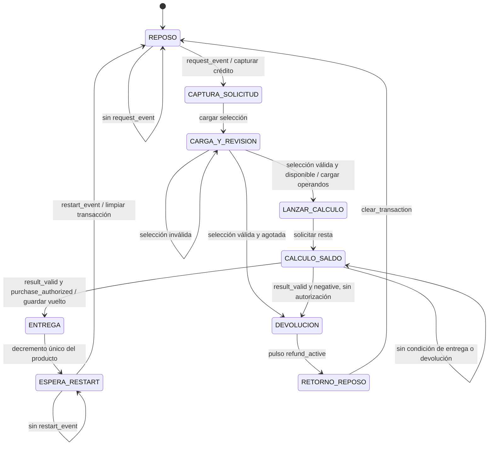

# Diagrama de estados de la máquina expendedora

La FSM tiene nueve estados One-Hot. La presentación de LED y display se mantiene en el wrapper.

El reset tiene prioridad desde cualquier estado: lleva a REPOSO e inhibe salidas. La ruta de datos restaura inventarios a tres. Un código de estado ilegal se recupera hacia REPOSO.

## Secuencia de cálculo

1. Antes de E0, producto y crédito están capturados.
2. En E0, CARGA_Y_REVISION carga precio y crédito si hay disponibilidad.
3. En E1, LANZAR_CALCULO solicita la resta; el restador registra el resultado y la FSM entra en CALCULO_SALDO.
4. En E2 se consume result_valid: con autorización se guarda vuelto y se entra en ENTREGA; con signo negativo se entra en DEVOLUCION.
5. Al salir de ENTREGA se reduce una sola unidad y comienza la espera de RESTART.

La FSM conserva la prioridad de purchase_authorized sobre negative si ambas condiciones llegaran a presentarse juntas. En la ruta de datos normal son excluyentes: la autorización exige signo no negativo.

## Presentación

El pulso de ENTREGA carga el registro visual del wrapper. Mantiene el LED y habilita los cuatro dígitos de vuelto hasta RESTART aceptado. El decremento sigue durando un ciclo.

DEVOLUCION y RETORNO_REPOSO duran un ciclo cada uno. El wrapper convierte refund_active en un LED de dos segundos y bloquea nuevas solicitudes durante ese intervalo. El display permanece en blanco en esa ruta.

tick_display habilita el refresco de los dígitos sin crear otro reloj. El valor del vuelto se conserva en change_reg durante la espera final.

## Interfaz de monedas

Los DIP físicos representan de cero a siete monedas de 100. Los ejemplos de 150 y 125 del enunciado se verifican directamente en el core. La devolución insuficiente es automática según la sección aritmética; no existe un pulsador de cancelación.
